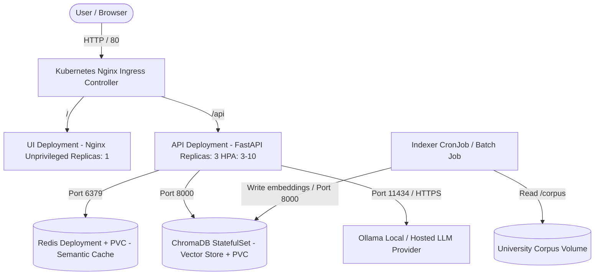
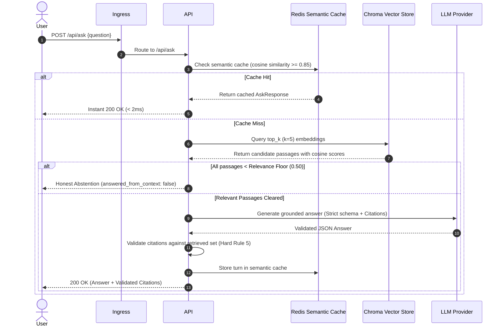

# RAHBAR Architecture & System Design

This document details the architectural layout, component interactions, and storage decisions behind the **RAHBAR Grounded RAG on Kubernetes** platform.

---

## 1. Workload Separation: StatefulSet vs Deployment

A central design requirement of RAHBAR is the strict separation between stateless compute and stateful vector/cache storage.

### Why ChromaDB is Deployed as a `StatefulSet`

ChromaDB is deployed as a Kubernetes `StatefulSet` (`k8s/base/chroma-statefulset.yaml`) rather than a standard `Deployment` for several architectural and operational reasons:

1. **Persistent On-Disk State & Storage Durability:**
   ChromaDB uses an embedded SQLite database for relational metadata and chunk tracking, coupled with dense HNSW (Hierarchical Navigable Small World) binary vector index files stored directly on the local filesystem (`/chroma/chroma`). This state must strictly persist across pod restarts, node drains, rescheduling, and cluster upgrades.

2. **Single-Writer Semantics & Concurrency Safety:**
   Chroma's embedded storage engine is fundamentally designed for single-writer access. If deployed as a multi-replica Deployment with shared block storage or ReadWriteMany volumes, concurrent write operations from multiple pods during indexing would lead to SQLite lock contention, database deadlocks, and index corruption. A StatefulSet guarantees exactly one active writer (`replicas: 1`) managing the underlying storage volume.

3. **Stable Network Identity:**
   StatefulSets provide deterministic, ordered network identifiers (`chroma-0.chroma.rahbar.svc.cluster.local`). This allows internal services (API and Indexer) to consistently address the storage instance without relying on transient, dynamic pod IP addresses.

4. **Dedicated Persistent Volume Claims (`volumeClaimTemplates`):**
   Unlike a Deployment which mounts an existing PVC or uses ephemeral scratch space, a StatefulSet leverages `volumeClaimTemplates` to automatically provision a dedicated `PersistentVolumeClaim` that remains permanently bound to that specific ordinal pod. If the `chroma-0` pod is terminated, Kubernetes restarts it on any available node and reattaches the exact same Persistent Volume without data loss.

### Contrast with Stateless API and UI Workloads

* **API (`Deployment`, `replicas: 3`, HPA enabled):**
  The FastAPI service is entirely stateless. It maintains zero in-memory state between requests, reading corpus embeddings exclusively from Chroma and cache entries from Redis. It scales horizontally from 3 to 10 replicas based on CPU utilization and request concurrency, utilizing `maxSurge: 1` and `maxUnavailable: 0` for zero-downtime rolling upgrades.
* **UI (`Deployment`, `replicas: 1`):**
  Serves static frontend assets (vanilla JS, CSS, HTML) via an unprivileged Nginx web server running as non-root user `10001`.

---

## 2. Decoupled Indexing Architecture (Indexer-as-Job)

In accordance with architectural best practices, indexing is completely decoupled from the API request-response lifecycle:

* **The API reads the index; it never builds it.** Startup probes in the API verify Chroma connectivity and embedding model parity (`EMBED_MODEL` pin), but perform zero corpus ingestion.
* **The Indexer runs as an isolated batch `Job` or `CronJob` (`k8s/base/indexer-job.yaml` and `k8s/base/reindex-cronjob.yaml`):**
  The indexer executes a 5-stage pipeline (extraction, cleaning, structure-aware chunking, embedding generation, Chroma upsert). Running as a batch workload ensures that memory spikes during heavy OCR or embedding generation do not degrade API query serving latency.

---

## 3. Two-Tier Caching & Honest Abstention Pipeline

1. **Semantic Cache (Tier 1):** Redis stores normalized query embeddings and response payloads. Incoming questions with cosine similarity $\ge 0.85$ are served in $<2\text{ms}$. Conversational follow-ups, out-of-scope inquiries, and abstentions are strictly excluded via `never_cache` rules.
2. **Relevance Floor & Honest Abstention (Tier 2):** Any query retrieving chunks whose similarity score falls below `0.50` triggers immediate abstention (`answered_from_context: false`), preventing LLM hallucinations.
3. **Hard Rule 5 Citation Guardrail:** Every citation emitted by the LLM is checked against the passages actually retrieved by Chroma. Any hallucinated citation is discarded prior to response serialization.
